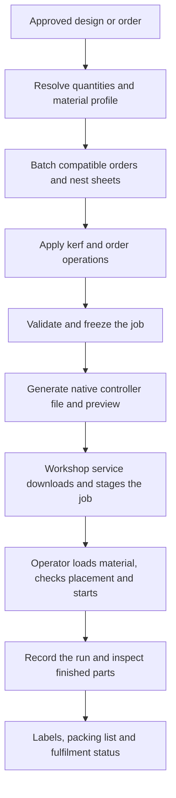

# Automated DSP laser workflow

Design decision and implementation status, 26 October 2026. The local implementation includes a controller-neutral laser planner, vector catalogue, a four-material library, versioned profiles, nesting, experimental Ruida export, immutable artifacts, a local queue and SKU order intake. Optional Shopify polling fills draft beds automatically by material and thickness. No machine connection or cutting trial has been performed.

The sections below describe the broader target architecture. Live Ruida transport, multi-component products, timed/automatic bed release, QR selection and fulfilment integration remain future work. The service polls Shopify directly when configured and automatically prepares draft beds across compatible orders; operator release freezes them. See [README](../README.md), [Shopify setup](SHOPIFY.md), [workshop API](WORKSHOP.md) and [controller integration and qualification status](CONTROLLERS.md) for the implemented behaviour.

The target is to turn an approved product and quantity, or an incoming production order, into a prepared job on the laser. Laser Marketplace owns the design, material settings, nesting, job generation and queue. A background workshop service handles communication with the controller. LightBurn is not part of the workflow.

## Recommended architecture

Use a wired Ethernet connection and a small, always-on Linux computer beside the machine. The computer can be an existing workshop PC; dedicated hardware is not needed during development. It runs the background service, maintains a local job cache and displays the same marketplace operator screen. The website talks to the jobs API; the workshop service connects outward to that API and communicates locally with the controller. The controller does not need to be exposed to the internet.

Ruida is the first controller family to target, with the RDC6445 family as the planning reference if the machine has not been selected. This is an engineering recommendation, not a claim about the user's eventual hardware or every model's compatibility. Ruida documents Ethernet communication, onboard files and standalone operation for the RDC6445GT5. The exact board and firmware must be recorded during commissioning. [Manufacturer description](https://www.rdacs.com/en/news-detail/97.html)

## The production flow

1. Store an approved vector design, component quantities and revision under each product SKU. New designs enter review once; repeat orders reuse that revision. AI-assisted designs can enter this same workflow after their dimensions and features have been checked.
2. Resolve each order into component quantities. Group jobs by compatible stock, thickness, machine and material-profile revision. Respect grain and rotation restrictions. Batch to a chosen dispatch time or sheet-utilisation target so waiting for a fuller sheet does not delay urgent orders.
3. Nest the original component geometry, including enough spacing for kerf and any required bridges. Apply kerf once and validate the final compensated paths and bed bounds. Reject unintended duplicate cuts, invalid units, ambiguous contours and unsupported entities. Open paths remain valid for intentional scoring.
4. Assign explicit operations: vector cut, vector score and, later, area/image engraving. Order engraving/scoring ahead of release cuts, and contained cut-outs ahead of their enclosing outlines. Start with cut and score; raster engraving adds scan planning, overscan and additional machine calibration.
5. Freeze an immutable job with source hashes, design revisions, quantities, layout, machine identity, origin, profile revision, encoder version and warnings. Emit one controller file per physical sheet, a preview SVG, a JSON manifest and the existing labels/cutting-list outputs. The native output must be decoded back into a preview for comparison with the planned paths and settings; a picture of the source alone does not validate the encoder.
6. The workshop service claims a job, downloads it, checks the artifact hash and stages it on the controller using the controller's validated upload-only operation. Cache files locally so a website disconnect does not remove an already prepared job.
7. The operator sees the required material, sheet number, origin and layout, loads and positions the stock, confirms focus/placement and starts at the machine. A QR code can select the correct job in the operator screen. Each sheet requires a fresh material setup and start.
8. Record the machine run separately from acceptance of the finished parts. Where tested controller telemetry identifies the run reliably, use it; otherwise use an explicit operator completion action. Update remaining quantities, generate replacement jobs for rejects and prepare the packing paperwork.

## Controller integration

Keep the machine-specific work behind an adapter. The proposed interface separates `compile`, `inspect`, `upload` and `status`; machine execution is a distinct operation. A file transfer must never implicitly mean "start cutting" in the application state machine.

The initial implementation uses a restricted original TypeScript RD codec, checked offline against pinned MeerK40t 0.9.9100. MeerK40t remains a backend candidate for broader device support. Its project documents a command-line automation interface and Ruida device support, and its Ruida device code includes a `save_job` implementation that writes the generated output to a file. It could run behind our service without adding another application to the operator's daily workflow. [Project documentation](https://github.com/meerk40t/meerk40t/blob/main/README.md), [native job export code](https://github.com/meerk40t/meerk40t/blob/main/meerk40t/ruida/device.py)

This is a feasibility candidate, not an accepted production dependency: the inspected Ruida registration is labelled beta and notes Linux testing. Pin a version and qualify it on the chosen controller before adopting it. The project publishes an MIT licence. [Ruida registration](https://github.com/meerk40t/meerk40t/blob/main/meerk40t/ruida/plugin.py), [licence](https://github.com/meerk40t/meerk40t/blob/main/LICENSE)

Independent Ruida work demonstrates native RD generation and UDP transfer, which supports the feasibility of a direct integration. Its protocol notes include uncertain commands, and the repository declares GPL-2.0; it is a research reference rather than a dependency selected for incorporation. If the first backend fails qualification, evaluate a supplier-supported SDK before expanding a custom implementation. [Protocol research](https://github.com/jnweiger/ruida-laser/blob/master/doc/protocol.md), [encoder implementation](https://github.com/jnweiger/ruida-laser/blob/master/src/ruida.py), [repository](https://github.com/jnweiger/ruida-laser)

Upload-only support, filename limits, memory limits, available status fields, origin behaviour and supported commands are capabilities to test on the actual model. A different DSP brand requires its own adapter; it does not change the order, design, nesting and job-management architecture.

## Material and machine profiles

Each approved profile belongs to a particular machine, material and measured thickness. Record speed in mm/s, minimum and maximum power where supported, pass count, measured kerf, focus/setup notes, air-assist requirements and operation type. Later engraving profiles also include scan interval and overscan requirements.

Material thickness alone is not enough to select power and speed. The initial commissioning process creates calibration samples and a verified first article. Successful settings become versioned presets used automatically on repeat jobs. The app should not invent production settings or silently substitute a profile for a different machine.

Machine profiles also hold usable bed size, axis orientation, origin convention, allowed settings, controller identity/firmware and tested adapter version. Focus automation and accessory control are enabled only if that machine has the corresponding hardware and the integration has been verified.

## Queue behaviour

Use explicit states such as `preparing`, `ready`, `transferring`, `staged`, `running`, `awaiting_inspection`, `complete`, `failed` and `needs_reconciliation`.

Give each sheet an immutable ID and hash, retain the controller filename mapping, and allow one service to own the machine transfer at a time. Bound retries and record acknowledgements. A lost response does not prove that the controller rejected the command: ambiguous transfers or execution states require reconciliation rather than blind resend or restart.

An upload acknowledgement proves neither cutting nor completion. An estimated duration is for planning only. Do not infer completion from elapsed time or advance production quantities merely because a file was transmitted. The next sheet can be prepared automatically, but a new order or reconnection must not trigger machine motion by itself. The machine's physical interlocks remain effective; the application does not replace them.

## Changes to the fork

| Existing area | Planned change |
| --- | --- |
| `src/models/Part.ts` and component storage | Introduce vector components with explicit operations and revisions; keep source dimensions independent of a machine program. |
| `src/cam/dxf.ts` and import UI | Reuse parsing where suitable, remove router-based hole classification and add SVG support with explicit units. Small laser holes retain their designed diameter. |
| `src/nesting` and sheet editor | Adapt footprints and placements to vector geometry rather than parsed G-code; validate compensated output and laser spacing. |
| `src/cam/materialProfiles.ts` and profile UI | Replace fixed router thickness/pass presets with versioned laser material and machine profiles. |
| `src/jobs/generateJob.ts` | Replace G-code concatenation and router preparation with immutable laser plans and controller adapters. Replace CNC line limits with measured geometry/output limits. |
| Jobs API, queue, orders, labels and packing | Reuse the useful infrastructure; add batching, per-sheet dispatch and machine-run reconciliation. |
| New workshop service | Add authenticated job retrieval, artifact verification, local persistence, controller upload and capability-based status reporting. |

Do not convert old router toolpaths into laser paths: they can already contain cutter offsets, ramps, tabs, dogbones and drill substitutions. Use the source drawing or a reviewed vector component. New laser jobs must not inherit spindle commands, screw marking, peck drilling or router Z moves.

## Implementation sequence and acceptance

1. **Offline laser planner:** introduce vector components, cut/score assignments, material profiles, nesting and preview/export. Verify dimensions, holes, operation order and kerf with representative fixtures.
2. **Native-file proof:** qualify the first Ruida encoder using single contours, nested holes, multiple layers and boundary cases. Decode and compare outputs. On the actual machine, verify transfer without start, orientation, dimensions, origin, settings and a supervised test cut before enabling production output.
3. **Workshop service:** implement persistent dispatch and staging. Test service restarts, lost acknowledgements, duplicate claims, busy controller, low memory and ambiguous transfer recovery. Keep controller selection explicit during setup; do not probe arbitrary devices.
4. **Order automation:** add material batching, automatic preparation for approved designs/profiles, job selection by QR code, operator run tracking, labels and replacement quantities.
5. **Optional extensions:** add raster engraving, verified telemetry and hardware-supported focus/accessory automation. Automatic loading/unloading or unattended multi-sheet production would require additional machine hardware and a separately designed production cell.

Development of the shared workflow can proceed now. The actual controller model is a commissioning dependency for the adapter, rather than a reason to delay the application architecture.
